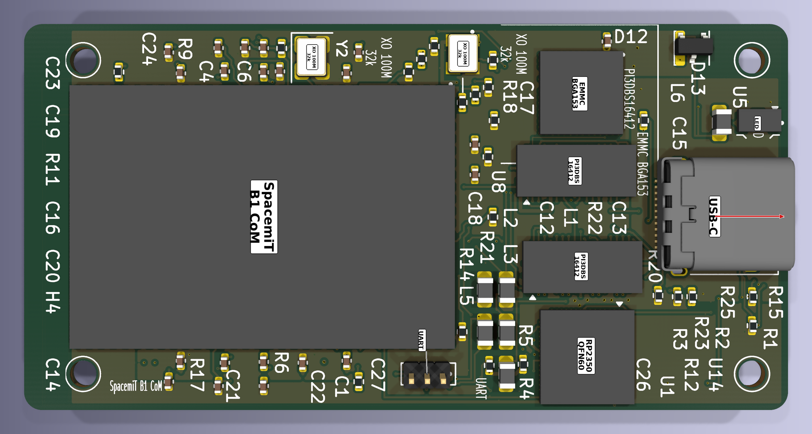
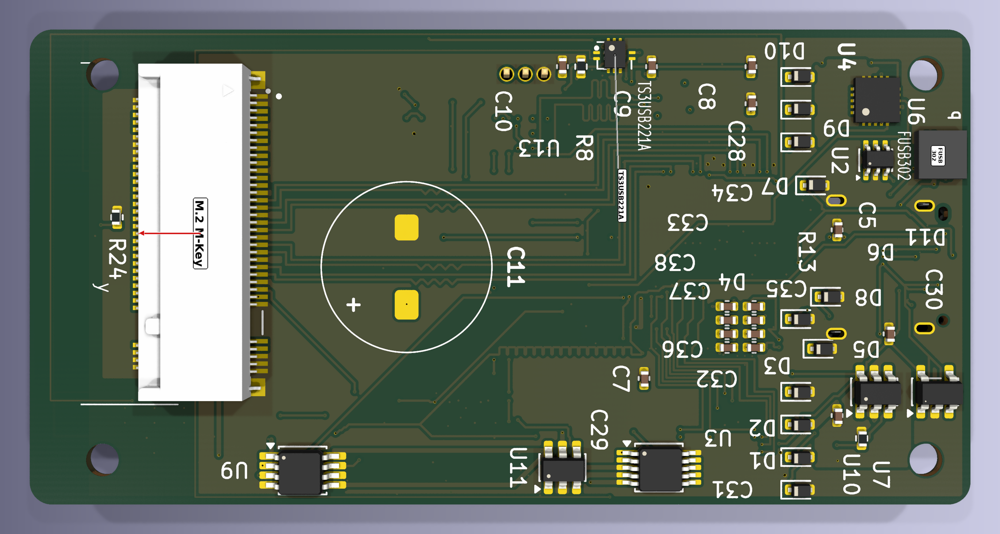

# hw_ic_key — KEY Secure Key Vault (B1 Security Module)

<p align="center">
  <a href="docs/img/top.png"></a>
  <a href="docs/img/bottom.png"></a>
</p>

<p align="center"><em>Current hardware revision — 8-layer, 32.00 × 63.40 mm PCB (TOP / BOTTOM)</em></p>

Open-source hardware — KiCad design files for the **KEY module**, the secure
key vault that gates the IOCONVERT V2.0 conversion card family. It carries
the hardware root of trust and issues the pre-authentication handshake before
any data path is enabled.

## Status

| Item | Value |
|---|---|
| PCB | 8 layers, 32.00 × 63.40 mm |
| Routing | 0 unrouted nets, DRC 0 violations |
| Fabrication data | Gerber (13 layers), Excellon drill, CPL, BOM — `fab/release_r5_u0/` |
| Design files | KiCad 10 (`key_v2.kicad_pro`, `key_v2.kicad_pcb`, `sch/`) |

## Overview

KEY is a B1 security module that connects to the K1 master gate card over
USB Type-C. It holds the hardware vault, flash storage, and the SE050 secure
element that performs mutual authentication with the gatekeeper MCU. Only
after successful pre-authentication is the PCIe data path allowed to start.

```
KEY (B1 security module)
├─ B1 hardware vault + eMMC flash
├─ SE050 secure element (pre-auth / mutual auth over SBU I2C)
├─ M.2 M-key socket
├─ FUSB302 USB-C controller
└─ Type-C link → K1 Master Gate Card
```

## Key Features

- **Secure element**: NXP SE050 (hardware root of trust, key storage)
- **Storage**: eMMC (BGA-153) + LPDDR4 (200-FBGA) memory subsystem
- **Compute**: SOM module (B1 platform) with PMIC + 100 MHz XO
- **Connectivity**: USB Type-C receptacle, M.2 M-key socket
- **Debug**: UART debug header

## Repository Contents

| Path | Description |
|---|---|
| `key_v2.kicad_pro` | KiCad 10 project |
| `key_v2.kicad_pcb` | PCB layout (current revision) |
| `sch/` | Schematics: root, main, power |
| `lib/key_v2_symbols.kicad_sym` | Symbol library — required for schematics |
| `lib/footprint/` | Footprint library (17 custom footprints) |
| `fab/key_v2_bom.csv` | Bill of materials |
| `fab/release_r5_u0/` | Fabrication package: Gerber, drill, CPL, BOM, `MANIFEST.md` |
| `boards/` | Configuration (YAML) |
| `docs/img/` | 3D renders used above |

## Getting Started

1. Install [KiCad](https://www.kicad.org/) 10.x
2. Clone this repository
3. Open `key_v2.kicad_pro`
4. If symbols/footprints show as missing, add `lib/key_v2_symbols.kicad_sym`
   to the symbol library table and `lib/footprint/` to the footprint library
   table (global or project-level)

## Fabrication

`fab/release_r5_u0/MANIFEST.md` lists every file with its SHA-256 and size.
Board stackup is 8-layer; blind/buried vias are used, so check with your
fabricator before ordering.

## License

AGPL-3.0 (see `LICENSE`)

---

*Part of the IOCONVERT V2.0 family: [hw_ic_k1](https://github.com/dataxcash/hw_ic_k1) (master gate card) · [hw_ic_k2](https://github.com/dataxcash/hw_ic_k2) (worker data-plane card)*
